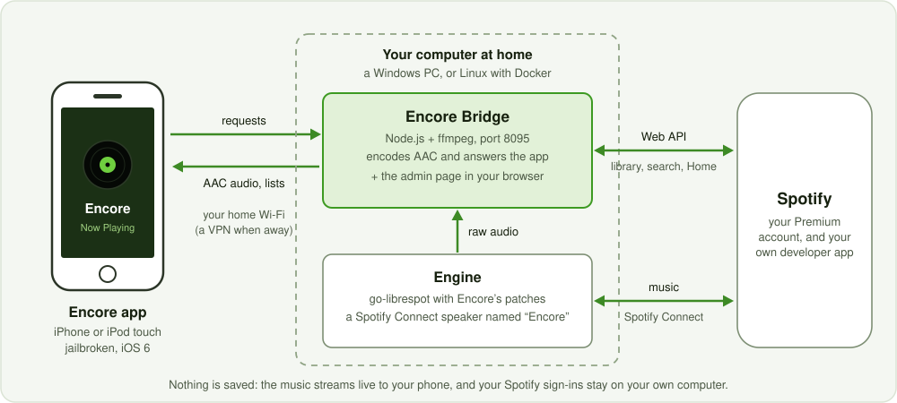

# Encore tutorial: pick yours

Setup takes about 20 minutes. Install the **Encore Bridge** on a computer at home. Its **setup guide**, in your
browser, then takes you through the rest, up to your first song.

> **Unofficial.** Not made, endorsed or supported by Spotify. Needs Spotify Premium and your own Spotify developer app.
> Uses private Spotify interfaces that may break anytime. Use at your own risk ([disclaimer](../README.md#disclaimer)).

You need a jailbroken iPhone or iPod touch with Cydia on iOS 5 or 6, Spotify Premium, and a computer that stays on.

| The computer that stays on | Your tutorial |
|---|---|
| Windows 10 or 11 PC (64-bit) | [Encore on Windows](TUTORIAL-WINDOWS.md) |
| 64-bit Linux with Docker (home server, NAS or spare PC) | [Encore with Docker](TUTORIAL-DOCKER.md) |

Docker Desktop on Windows or macOS doesn't work: on a Windows PC, use the Windows bridge.
Models, troubleshooting and everything else: [the Encore guide](GUIDE.md).
